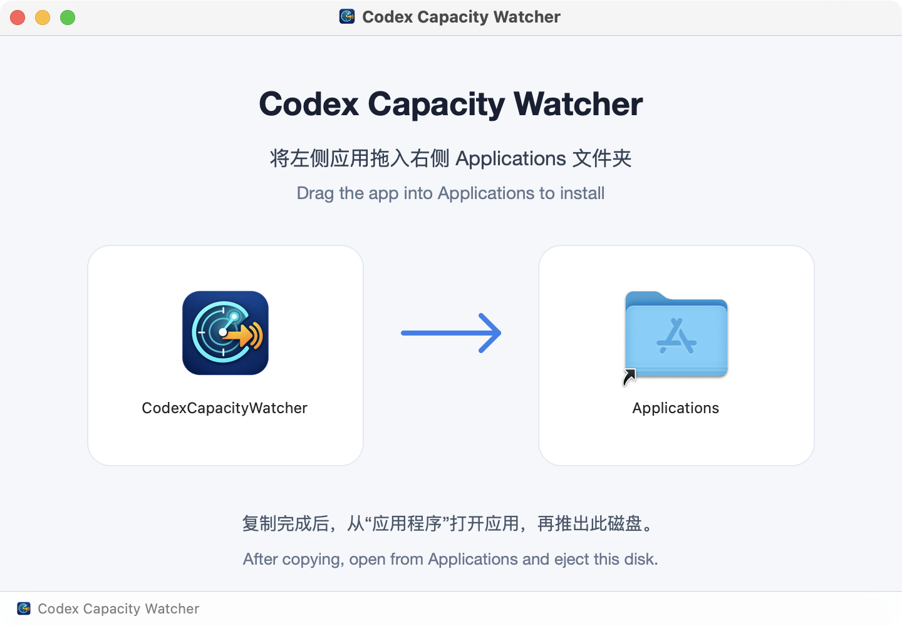
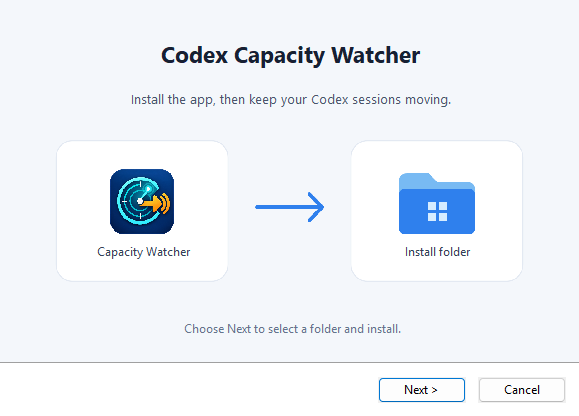

# Codex Capacity Watcher

Automatically sends a follow-up to local Codex sessions stopped by model-capacity errors. It supports terminal Codex CLI, Codex in VS Code, Codex sessions in the Codex/ChatGPT desktop clients, and `codex exec`.

Use the desktop app on Windows or macOS, or run the command-line watcher from source. The watcher reads local session logs and sends `continue` by default to the original session through `codex queue`.

[简体中文](README.zh-CN.md)

## Features

- Watches new task-completion events in `CODEX_HOME/sessions/**/rollout-*.jsonl`.
- Handles capacity errors containing `Selected model is at capacity. Please try a different model`.
- Lets you choose terminal, VS Code, desktop, and `codex exec` sessions independently.
- Provides a Windows/macOS desktop app with English and Chinese, live logs, and background monitoring from the system tray or menu bar.
- Sends a configurable follow-up to the original session, once per failed turn.
- Supports preview mode without sending messages, a configurable scan interval, and recovery of recent sessions still stopped by a capacity error.
- Persists processed file offsets and queued events so restarting the watcher does not resend messages.
- Can be started and stopped from the desktop app or managed through the command-line entry point.

## Supported sessions

| Session source | Command-line selection |
| --- | --- |
| Terminal Codex CLI / TUI | `cli` |
| Codex in VS Code | `vscode` |
| Codex sessions in Codex/ChatGPT desktop clients | `desktop` |
| Non-interactive `codex exec` runs | `exec` |

A fresh desktop-app configuration selects all four types. The command-line
watcher defaults to terminal sessions; use `--session-types` to choose others.
Subagent sessions are excluded by default and can be enabled separately.

Monitoring covers local rollout files under the selected `CODEX_HOME/sessions`
directory. Select the Codex home containing the sessions you want to monitor;
the default is `$CODEX_HOME`, or `~/.codex` when unset. Desktop support refers
to Codex sessions with local rollout logs, not general ChatGPT conversations.

## Requirements

- Local rollout files from the Codex sessions you want to monitor.
- An installed Codex CLI supporting `codex queue` to send follow-ups for any
  selected session type. Make it available on `PATH`, select its executable in
  the desktop app, or pass `--codex` when running the command-line watcher.
- Release installers include the Python runtime and GUI dependencies.
  Running from source requires Python 3.10 or newer, plus PySide6 for the GUI.

## Download and start

| Platform | Download |
| --- | --- |
| Windows | [EXE installer](https://github.com/Binkle/fk-codex-capacity-limit/releases/latest/download/CodexCapacityWatcher-Setup.exe) · [MSI package](https://github.com/Binkle/fk-codex-capacity-limit/releases/latest/download/CodexCapacityWatcher-Setup.msi) |
| macOS | [DMG installer](https://github.com/Binkle/fk-codex-capacity-limit/releases/latest/download/CodexCapacityWatcher-macos.dmg) · [ZIP archive](https://github.com/Binkle/fk-codex-capacity-limit/releases/latest/download/CodexCapacityWatcher-macos.zip) |

1. Install the Windows package, or open the macOS DMG and drag the app into Applications.
2. Open **Codex Capacity Watcher** and check the Codex home and Codex executable paths in Settings.
3. Select the session types to monitor and click **Start monitoring**. Enable preview mode first if you want to inspect detected events without sending messages.

The app follows the system language and lets you switch between English and
Chinese in the window header. Each installer includes both app languages.
The EXE installation wizard supports English and Chinese; the single MSI uses
an English installation wizard. [Releases](https://github.com/Binkle/fk-codex-capacity-limit/releases/latest)
also includes `SHA256SUMS` for verifying downloads.

## Command-line usage

With Python installed, run the watcher from the repository root:

```bash
python3 scripts/codex_capacity_watcher.py
```

Command-line defaults:

| Setting | Default |
| --- | --- |
| Codex home | `$CODEX_HOME`, or `~/.codex` when unset |
| State file | `$CODEX_HOME/capacity-watcher-state.json` |
| PID file | `capacity-watcher.pid` next to the state file |
| Codex executable | `$CODEX_BIN`, or `codex` when unset |
| Session types | Terminal CLI only |
| Follow-up message | `continue` |
| Poll interval | 2 seconds |

Preview what would be sent without calling `codex queue`:

```bash
python3 scripts/codex_capacity_watcher.py --dry-run --once
```

Stop a watcher that is already running:

```bash
python3 scripts/codex_capacity_watcher.py --stop
```

If the watcher was started with a custom PID file, pass the same path when stopping it:

```bash
python3 scripts/codex_capacity_watcher.py --stop --pid-file /path/to/capacity-watcher.pid
```

Recover sessions that have remained in a capacity-error state during the last six hours when the watcher starts:

```bash
python3 scripts/codex_capacity_watcher.py --recover --recover-hours 6
```

The command-line default monitors terminal CLI sessions. To monitor all four supported types, use a comma-separated list:

```bash
python3 scripts/codex_capacity_watcher.py --session-types cli,vscode,desktop,exec
```

Pass a subset such as `--session-types vscode,desktop` to monitor only those
sources. The legacy `--all-sessions` switch remains supported and includes all
session types.

To include subagent sessions:

```bash
python3 scripts/codex_capacity_watcher.py --include-subagents
```

See all available options:

```bash
python3 scripts/codex_capacity_watcher.py --help
```

## Desktop app

The desktop app provides a single Start/Stop button, a scan-interval field,
Codex/state-file selectors, the follow-up message, recovery, independent
checkboxes for terminal CLI, VS Code, ChatGPT/Codex desktop, and `codex exec`,
the startup look-back window, preview mode, and a live log window. The
interface supports English and Chinese, follows the system language by
default, and lets you switch language from the application header. All four
session types are selected in a new installation. Closing the main window keeps
monitoring running, with an icon in the macOS menu bar or Windows notification
area. Choose **Show window** to reopen the window, or **Quit application** to stop
monitoring and exit (also available from the application menu and via ⌘Q on macOS).
To exit when closing the window, turn off **Keep running after closing the main
window** in Settings. If the system tray is unavailable, closing exits the app.

On macOS, download the `.dmg` from [Releases](https://github.com/Binkle/fk-codex-capacity-limit/releases/latest)
and double-click it. In the installation window, drag **CodexCapacityWatcher**
onto the **Applications** folder on the right. Wait for the copy to finish,
open the app from Applications, then eject the disk image. When updating,
quit the previous version from its menu-bar menu before replacing it.



On Windows, download the [EXE installer](https://github.com/Binkle/fk-codex-capacity-limit/releases/latest/download/CodexCapacityWatcher-Setup.exe)
or [MSI package](https://github.com/Binkle/fk-codex-capacity-limit/releases/latest/download/CodexCapacityWatcher-Setup.msi).
Both install the same application with English and Chinese available in its language selector.

When updating on Windows, use the same installer format as the existing installation.
First choose **Quit application** from the app or its system-tray menu; closing
the main window can leave the app running and lock the executable. If EXE setup
asks you to close the app, quit it and choose **Retry**, or **Cancel** to keep the
existing installation. Silent EXE setup exits with the Windows file-access error
code if the executable cannot be replaced, without changing the installation.
If MSI reports **The EXE edition is already installed**, close the installer,
uninstall **Codex Capacity Watcher** from **Settings → Apps → Installed apps**,
then run the MSI again. The same procedure applies when switching from MSI to
EXE. Uninstalling preserves your personal settings and Codex session data.

To run from source, on macOS double-click `run-codex-capacity-watcher.command`. On Windows,
double-click `run-codex-capacity-watcher.bat`. The source launcher requires
Python 3.10+ with PySide6. Install the GUI dependency with
`python3 -m pip install -r requirements-gui.txt` when running from source.

## Build and release

To build a standalone application for the current operating system, install
Python and run the matching build script:

```bash
# macOS
sh packaging/build-macos.sh

# Windows (Command Prompt)
packaging\build-windows.bat
```

The macOS build creates an installable
`dist/CodexCapacityWatcher-macos.dmg`, a distributable
`dist/CodexCapacityWatcher-macos.zip`, and the app bundle. The Windows build
creates a guided EXE and a single Windows Installer package:

- `dist\CodexCapacityWatcher-Setup.exe`: follows the Windows display language
  (English or Simplified Chinese), with an optional desktop shortcut.
- `dist\CodexCapacityWatcher-Setup.msi`: English installation and maintenance UI.
  The installed application follows the system language and supports switching
  between English and Chinese; no separate language package is needed.

Both formats let you choose the installation folder, create a Start menu shortcut,
and provide an uninstall entry in Windows Settings. MSI also supports repair and
standard `msiexec` deployment. Choose one format; uninstall it before switching
between EXE and MSI. Installation requires administrator privileges. The welcome
page follows the macOS installer's pale background, cards, and directional guide.



Distribute the macOS DMG or zip;
the zip preserves the Qt/PySide6 symlinks so the bundle does not expand when it
is copied with a generic file tool. The application icon is embedded in the
macOS app, Windows installer, and runtime window. PyInstaller packages the
watcher and GUI together, so the person using the finished application does
not need to run the Python script manually.

The Windows build requires [NSIS](https://nsis.sourceforge.io/Download) and the
.NET 8 SDK. The MSI build restores the pinned WiX 5.0.2 tool and UI extension.
Use `packaging\build-windows.bat exe` or `packaging\build-windows.bat msi` to build
only one format. Add `--skip-app` as the second argument to reuse an existing
`dist\CodexCapacityWatcher.exe` while editing the installer. Normal builds always
rebuild the application. The editable vector artwork is in `packaging/assets/windows-*.svg`.
For an unattended MSI install from an elevated terminal, use
`msiexec /i CodexCapacityWatcher-Setup.msi /qn /norestart`; pass
`INSTALLFOLDER="C:\Apps\CodexCapacityWatcher"` to choose a directory.
MSI upgrades, including upgrades from the earlier English or Chinese packages, keep the
existing installation folder unless you explicitly choose another one. Uninstalling
either format preserves your personal settings and session data.

The macOS build uses the system `hdiutil`, `ditto`, and `iconutil` tools and installs
`dmgbuild` automatically. The DMG includes an Applications shortcut and a bilingual
drag-to-install background. The build verifies the finished image's app signature,
bundle symlinks, installation shortcut, and Finder layout before reporting success.

The repository also includes a GitHub Actions workflow at
`.github/workflows/build-desktop.yml`. Manual runs create downloadable Actions
artifacts. To publish a release, update the matching versions in
`packaging/windows-installer.wxs` and `packaging/windows-installer.nsi`, then push
to `master`. Once both builds pass, the workflow creates the version tag and
publishes the EXE, MSI, macOS DMG/ZIP, and `SHA256SUMS` under Releases. A version
already tagged at a different commit is left unchanged. Pushing a matching `v*`
tag also publishes a release; retrying that build replaces its release assets.

## How it works

The watcher stores the read offset for each rollout file and records queued events in its state file. When it detects a new capacity error, it extracts the session ID and turn ID, then calls `codex queue` to send the follow-up to the original session. Failed sends are not marked as processed, so a later scan can retry them.

The watcher records its process ID in the PID file while it is running. On macOS/Linux, `--stop` sends that process a graceful `SIGTERM`; the watcher cleans up the PID file before exiting. On Windows, it terminates the process, waits for it to exit, and removes the matching PID file. On macOS/Linux, if no valid PID file exists, `--stop` also looks for Python processes running this script, which allows it to stop watchers created by older versions. A normal restart skips events appended while the watcher was stopped and begins at the current end of each rollout file. Use `--recover` to inspect existing history once at startup; after that recovery pass, the watcher follows only new events. Use `--state-file` and `--pid-file` to store state and process metadata in different locations.

## Tests

Run the syntax check:

```bash
python3 -m py_compile scripts/codex_capacity_watcher.py
```

If pytest is installed, run the test suite:

```bash
python3 -m pytest -q scripts/tests
```
