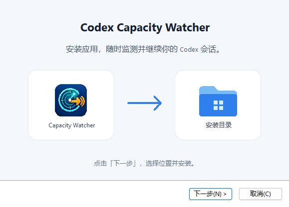

# Codex Capacity Watcher

[English](README.md)

为因模型容量不足而中断的本地 Codex 会话自动发送续跑消息，支持终端 Codex CLI、VS Code 中的 Codex、Codex/ChatGPT 桌面客户端中的 Codex 会话，以及 `codex exec`。

提供 Windows、macOS 桌面应用，也可以通过命令行运行源码。程序监控本地会话日志，默认通过 `codex queue` 向发生错误的原会话发送 `continue`。

## 功能

- 监控 `CODEX_HOME/sessions/**/rollout-*.jsonl` 中的新任务完成事件。
- 只处理容量错误：`Selected model is at capacity. Please try a different model`。
- 分别选择终端、VS Code、桌面端和 `codex exec` 会话。
- 提供中英双语 Windows/macOS 桌面应用、实时日志，以及系统托盘或菜单栏后台监控。
- 向原会话发送可自定义的续跑消息，每个失败回合只发送一次。
- 支持仅预览不发送、自定义扫描间隔，以及恢复最近仍停在容量错误的会话。
- 用状态文件记录读取位置和已发送事件，重启监控后不会重复发送。
- 可在桌面应用中开始、停止监控，也可通过命令行管理监控进程。

## 支持的会话来源

| 会话来源 | 命令行选项值 |
| --- | --- |
| 终端 Codex CLI / TUI | `cli` |
| VS Code 中的 Codex | `vscode` |
| Codex/ChatGPT 桌面客户端中的 Codex 会话 | `desktop` |
| 非交互式 `codex exec` 运行 | `exec` |

桌面应用首次使用时默认勾选全部四类会话；命令行脚本默认只监控终端会话，
可通过 `--session-types` 选择其他类型。子代理会话默认不包含，可单独启用。

监控范围是所选 `CODEX_HOME/sessions` 目录中的本地 rollout 日志。
请选择实际存放目标会话的 Codex 主目录，默认使用 `$CODEX_HOME`，未设置时为
`~/.codex`。桌面端支持指有本地 rollout 日志的 Codex 会话，不包含普通 ChatGPT 对话。

## 环境要求

- 要监控的 Codex 会话在本地生成了 rollout 日志。
- 已安装支持 `codex queue` 的 Codex CLI，用于向所选类型的会话发送续跑消息。
  可将其加入 `PATH`、在桌面应用中选择程序路径，或在命令行中通过 `--codex` 指定。
- Release 安装包已包含 Python 运行时和 GUI 依赖，无需另装 Python。
  仅源码运行需要 Python 3.10 或更高版本，源码 GUI 还需安装 PySide6。

## 下载与开始使用

| 平台 | 下载 |
| --- | --- |
| Windows | [EXE 安装包](https://github.com/Binkle/fk-codex-capacity-limit/releases/latest/download/CodexCapacityWatcher-Setup.exe) · [MSI 安装包](https://github.com/Binkle/fk-codex-capacity-limit/releases/latest/download/CodexCapacityWatcher-Setup.msi) |
| macOS | [DMG 安装包](https://github.com/Binkle/fk-codex-capacity-limit/releases/latest/download/CodexCapacityWatcher-macos.dmg) · [ZIP 压缩包](https://github.com/Binkle/fk-codex-capacity-limit/releases/latest/download/CodexCapacityWatcher-macos.zip) |

1. 运行 Windows 安装包；macOS 打开 DMG 后，将应用拖入 Applications（应用程序）。
2. 打开 **Codex Capacity Watcher**，在设置中确认 Codex 主目录和 Codex 程序路径。
3. 勾选要监控的会话类型，点击“开始监控”。如需先观察检测结果而不发送消息，可先启用预览模式。

程序默认跟随系统语言，可在窗口顶部切换中文和英文，每个安装包都包含两种应用语言。
EXE 安装向导支持中文和英文，统一的 MSI 使用英文安装向导。
[Releases](https://github.com/Binkle/fk-codex-capacity-limit/releases/latest) 中还提供了
`SHA256SUMS`，可用于校验下载文件。

## 命令行使用

安装 Python 后，在仓库根目录运行：

```bash
python3 scripts/codex_capacity_watcher.py
```

命令行脚本的默认配置如下：

| 配置 | 默认值 |
| --- | --- |
| Codex 主目录 | `$CODEX_HOME`，未设置时为 `~/.codex` |
| 状态文件 | `$CODEX_HOME/capacity-watcher-state.json` |
| PID 文件 | 状态文件所在目录中的 `capacity-watcher.pid` |
| Codex 命令 | `$CODEX_BIN`，未设置时为 `codex` |
| 会话类型 | 仅终端 CLI |
| 发送内容 | `continue` |
| 扫描间隔 | 2 秒 |

先观察而不发送消息：

```bash
python3 scripts/codex_capacity_watcher.py --dry-run --once
```

停止已经运行的监控进程：

```bash
python3 scripts/codex_capacity_watcher.py --stop
```

如果启动时使用了自定义 PID 文件，停止时传入相同路径：

```bash
python3 scripts/codex_capacity_watcher.py --stop --pid-file /path/to/capacity-watcher.pid
```

启动时恢复最近 6 小时内仍停在容量错误的会话：

```bash
python3 scripts/codex_capacity_watcher.py --recover --recover-hours 6
```

命令行脚本默认只监控终端 CLI 会话。如需监控全部四类会话：

```bash
python3 scripts/codex_capacity_watcher.py --session-types cli,vscode,desktop,exec
```

也可以只选择部分来源，例如 `--session-types vscode,desktop`。
旧的 `--all-sessions` 参数仍然可用，会包含全部会话类型。

如需监控子代理会话：

```bash
python3 scripts/codex_capacity_watcher.py --include-subagents
```

完整参数：

```bash
python3 scripts/codex_capacity_watcher.py --help
```

## 桌面应用

桌面应用使用一个“开始监控/停止监控”
切换按钮，支持设置扫描间隔，选择 Codex 主目录、状态文件和 Codex 程序，
修改发送内容，并分别勾选终端 CLI、VS Code、ChatGPT/Codex 桌面端和
`codex exec`。新安装默认勾选全部四类会话，也可以选择是否恢复历史、是否
包含子代理，并查看实时日志。界面支持中文和 English，默认跟随系统语言，
也可以在窗口顶部切换；“回看时间”用于处理监控停止期间最近的限流会话。
点击关闭按钮会关闭主窗口，监控继续后台运行，macOS 顶部菜单栏或 Windows
通知区域保留图标。从图标菜单选择“显示窗口”可重新打开，“退出应用”会停止
监控并结束程序，也可通过应用菜单退出（macOS 支持 ⌘Q）。在“运行设置”中
取消“关闭主窗口后继续后台运行”，关闭按钮就会退出应用；系统托盘不可用时，
关闭按钮也会退出应用。

macOS 安装：从 [Releases](https://github.com/Binkle/fk-codex-capacity-limit/releases/latest)
下载并双击 `.dmg`，在安装窗口中把左侧 **CodexCapacityWatcher** 拖到右侧
**Applications（应用程序）** 文件夹。等待复制完成，从“应用程序”打开应用，
然后推出安装磁盘。更新时，先从顶部菜单栏菜单选择“退出应用”，再替换旧版。


Windows 安装：下载 [EXE 安装包](https://github.com/Binkle/fk-codex-capacity-limit/releases/latest/download/CodexCapacityWatcher-Setup.exe)
或 [MSI 安装包](https://github.com/Binkle/fk-codex-capacity-limit/releases/latest/download/CodexCapacityWatcher-Setup.msi)。
两种格式安装的是同一个程序，都可以在程序顶部切换中文和英文。

Windows 升级时请使用与现有安装相同的格式。先从应用菜单或系统托盘菜单选择
**退出应用**；只关闭主窗口可能仍在后台运行，导致程序文件被占用。
EXE 安装向导提示文件被占用时，退出应用后点击**重试**，或点击**取消**保留现有安装。
静默安装遇到文件无法替换时会返回 Windows 文件访问错误码，不改动现有安装。
如果 MSI 提示
**The EXE edition is already installed**，请先关闭安装向导，在
**设置 → 应用 → 已安装的应用** 中卸载 **Codex Capacity Watcher**，再运行 MSI。
从 MSI 切换到 EXE 时也按此顺序操作。卸载会保留个人设置和 Codex 会话数据。

源码启动：macOS 可以双击 `run-codex-capacity-watcher.command`，Windows 可以双击
`run-codex-capacity-watcher.bat`。直接运行源码时需要 Python 3.10 及以上，
并安装 PySide6。源码运行前可以执行
`python3 -m pip install -r requirements-gui.txt`。

## 构建与发布

在对应系统上构建包含 Python 运行时的独立应用：

```bash
# macOS
sh packaging/build-macos.sh

# Windows（命令提示符）
packaging\build-windows.bat
```

macOS 构建结果包括可双击安装的 `dist/CodexCapacityWatcher-macos.dmg`、
可分发的 `dist/CodexCapacityWatcher-macos.zip` 和应用本体；Windows 构建结果是
以下两种安装包：

- `dist\CodexCapacityWatcher-Setup.exe`：跟随 Windows 显示语言，支持中文和英文，可选择创建桌面快捷方式。
- `dist\CodexCapacityWatcher-Setup.msi`：统一使用英文安装与维护界面。
  程序默认跟随系统语言，安装后可切换中文和英文，无需选择不同语言的安装包。

两种格式都支持选择安装目录、创建开始菜单快捷方式，并在 Windows 设置中提供卸载入口。
MSI 还支持修复与标准 `msiexec` 静默部署。请选择一种格式；切换 EXE 与 MSI 前先卸载旧版本。
安装需要管理员权限。欢迎页沿用 macOS 版的浅色背景、卡片布局和方向引导。



macOS 请优先分发 dmg 或 zip；zip 会保留
Qt/PySide6 所需的符号链接，避免使用普通复制工具后体积膨胀。应用图标已经内置
到 macOS 应用、Windows 安装程序和运行窗口中。PyInstaller 会把 GUI 和监控脚本
一起打包，使用者不需要再手动运行 Python 脚本。

Windows 构建需要安装 [NSIS](https://nsis.sourceforge.io/Download) 和 .NET 8 SDK，
MSI 构建会自动恢复固定版本的 WiX 5.0.2 及其 UI 扩展。
只构建一种格式可运行 `packaging\build-windows.bat exe` 或 `packaging\build-windows.bat msi`。
调整安装页面时，可在第二个参数添加 `--skip-app`，复用已有应用 EXE；正常构建会重新打包应用。
可编辑的矢量素材位于 `packaging/assets/windows-*.svg`。
在管理员终端中运行 `msiexec /i CodexCapacityWatcher-Setup.msi /qn /norestart` 可静默安装，
添加 `INSTALLFOLDER="C:\Apps\CodexCapacityWatcher"` 可指定目录。
MSI 覆盖升级（包括从之前的中文或英文包升级）会保留原安装目录，除非明确指定新位置。
两种格式卸载时都会保留个人设置和会话数据。

macOS 构建使用系统自带的 `hdiutil`、`ditto` 和 `iconutil`，脚本会自动安装 `dmgbuild`。
DMG 内含 Applications 快捷入口和中英双语拖拽安装背景；构建结束前会挂载成品，
检查应用签名、包内符号链接、安装快捷入口和 Finder 窗口布局。

公开分发 macOS 版本前，请按[本机签名与公证说明](docs/macos-signing.md#中文)完成正式验证。
临时签名的开发包通过完整性校验，并不代表已通过 Apple 公证。

仓库还提供了 `.github/workflows/build-desktop.yml`。在 Actions 页面手动运行会生成构建产物。
发布新版时，同步修改 `packaging/windows-installer.wxs` 和 `packaging/windows-installer.nsi`
中的版本号并推送到 `master`；两个平台构建成功后，会自动创建版本标签，并在 Releases
发布 EXE、MSI、macOS DMG/ZIP 和 `SHA256SUMS`。若该版本已指向其他提交，会保留原发布内容。
也可以推送与安装包版本一致的 `v*` 标签来发布；重跑同一版本构建会更新它的发布附件。

## 工作方式

脚本会保存每个 rollout 文件的读取位置，并将已发送的事件写入状态文件。检测到新的容量错误后，它会提取 session ID 和 turn ID，调用 `codex queue` 向原会话发送消息。发送失败时不会把事件标记为已处理，下一轮扫描可以再次尝试。运行期间，脚本会将进程号写入 PID 文件；在 macOS/Linux 上，`--stop` 发送 `SIGTERM` 请求优雅退出，由监控进程清理 PID 文件；在 Windows 上，它终止进程并等待退出，再清理匹配的 PID 文件。如果 macOS/Linux 上没有有效的 PID 文件，`--stop` 还会查找正在运行的旧版本脚本进程并停止它们。

普通重启会跳过监控停止期间追加的历史事件，从每个 rollout 文件的当前末尾开始监听。只有显式使用 `--recover` 时，脚本才会在启动时检查已有历史记录；恢复检查完成后也只监听新事件。状态文件和 PID 文件可以分别通过 `--state-file`、`--pid-file` 指定到其他位置。

## 测试

运行语法检查：

```bash
python3 -m py_compile scripts/codex_capacity_watcher.py
```

如果环境已安装 pytest，运行测试：

```bash
python3 -m pytest -q scripts/tests
```
